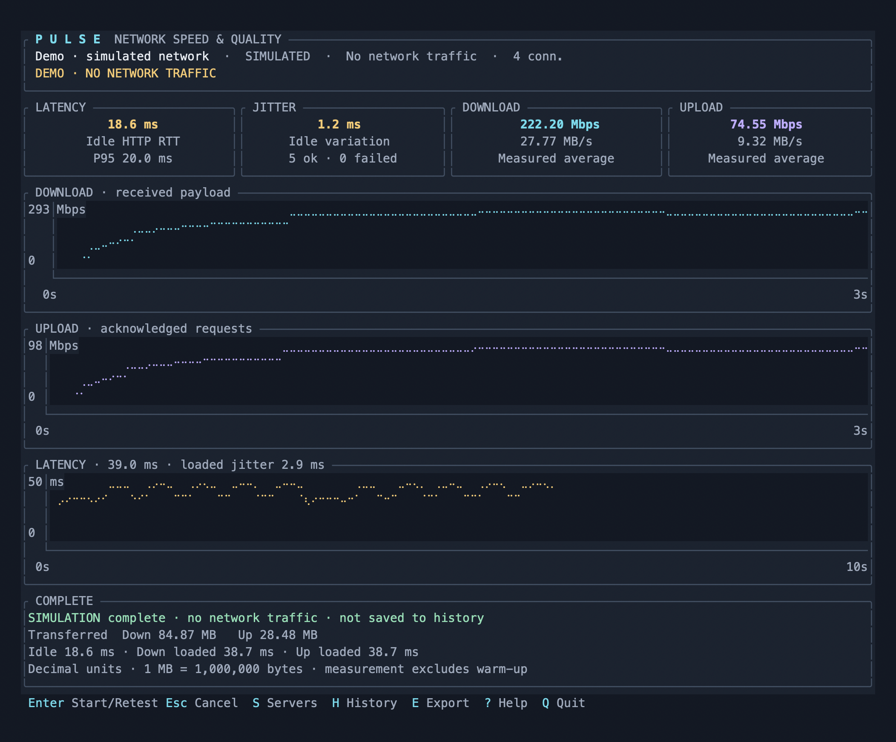

# Pulse

A Rust terminal dashboard for download speed, upload speed, latency, and jitter.

Pulse displays **Mbps**, **MB/s**, and total transferred **MB** together, with live throughput and latency graphs. The dashboard uses Ratatui; the asynchronous measurement engine uses Tokio and Reqwest. By default, Pulse uses public LibreSpeed servers with automatic server selection. An optional companion Axum server supplies streaming payloads and server-received upload counters for controlled tests.



*A terminal capture at 120 × 42. Metrics shown are from the explicitly labeled demo mode.*

## Quick start

Install Rust 1.89 or newer, then build both binaries:

```sh
cargo build --release --locked
```

Open the dashboard and press **Enter**:

```sh
./target/release/pulse --color always
```

Pulse loads the public [LibreSpeed server directory](https://librespeed.org/backend-servers/servers.php), probes candidates concurrently, and chooses the lowest median HTTP(S) RTT among servers that pass download and upload checks. No server setup is required. Press **S** to select a public server manually.

If a selected public server fails during a full measurement, automatic mode tries the next ranked candidate, with at most three full measurement attempts. Each attempt starts fresh. A manually selected single server reports its failure directly. The saved result identifies any failed prior attempts in `failed_servers`; byte totals and graphs describe the final successful server and exclude discarded attempts.

The directory is cached locally after successful fetches. If the default directory is unavailable, Pulse uses that cache, then a small bundled list of public servers in Los Angeles, London, and Prague. All candidates are rechecked before measurement. An explicitly configured directory that fails produces an error rather than silently changing the server set.

Try the interface without any server or network traffic:

```sh
./target/release/pulse --demo
```

Demo metrics simulate upload and download speeds building gradually and fluctuating below a 10,000 Mbps ceiling, with idle latency around 12 ms. They are explicitly labeled and are never added to measurement history. Demo mode skips warm-up and uses the configured duration for each simulated direction.

## Choose a public server

List the available servers, without running a speed test:

```sh
./target/release/pulse --list-servers
./target/release/pulse --list-servers --json
```

Use an ID from the list:

```sh
./target/release/pulse --server-id 54
```

To supply a LibreSpeed backend directly, specify its provider and backend directory:

```sh
./target/release/pulse --provider librespeed \
  --server https://la.speedtest.clouvider.net/backend
```

Direct backend URLs use the standard `garbage.php` download and `empty.php` upload/latency paths. A custom server directory preserves its own `dlURL`, `ulURL`, and `pingURL` mappings, including alternate names and subdirectories:

```sh
./target/release/pulse --server-list https://example.com/servers.json
./target/release/pulse --server-list servers.json --server-id 1
```

Directories use LibreSpeed's standard JSON format. Measurement paths must share their backend's origin. Scheme-relative backend URLs use HTTPS. Invalid endpoint entries are skipped; an empty or invalid directory fails clearly.

## Use your own Pulse server

For a local smoke test, start the server in one terminal:

```sh
./target/release/pulse-server
```

Then open Pulse in another:

```sh
./target/release/pulse --provider pulse --color always
```

The Pulse provider defaults to `http://127.0.0.1:8787`. A loopback test measures the local machine and networking stack; it does **not** measure your internet connection.

Run the companion server on another machine for a controlled remote test:

```sh
PULSE_SERVER_TOKEN=your-token ./target/release/pulse-server \
  --bind 0.0.0.0:8787 --name "Singapore 01"
```

Then connect from the client:

```sh
PULSE_TOKEN=your-token ./target/release/pulse --provider pulse \
  --server http://your-server:8787
```

For compatibility with the original release, explicit `--server` URLs without a provider still select the Pulse protocol. Use `--provider librespeed` for public backend URLs. Existing TOML files containing only `servers` also retain Pulse behavior. Bearer tokens are used only for the Pulse provider; they are never sent to public servers or the public directory.

For HTTPS on your server, use a TLS reverse proxy. Disable compression, caching, request buffering, and response buffering on measurement routes. Allow streaming uploads of at least 8 MiB and request durations longer than the test. The server's capacity should exceed the connection being measured.

Repeat `--server` to choose the reachable candidate with the lowest median RTT:

```sh
./target/release/pulse --provider pulse \
  --server https://speed-a.example.com \
  --server https://speed-b.example.com \
  --duration 10 --warmup 2 --connections 4
```

## Controls

| Key | Action |
| --- | --- |
| Enter | Start or repeat a full test |
| Esc | Cancel a test or close a dialog |
| S | Choose a server; A adds a backend URL for the current provider |
| H | Browse the last 100 completed tests |
| E | Export the current result or selected history entry |
| Up / Down, J / K | Navigate server and history lists |
| ? | Show help |
| Q / Ctrl-C | Quit and stop active transfers |

The dashboard adapts to terminal size. A 120 × 42 terminal displays three separate graphs; smaller windows combine the throughput graphs. Very small windows use a compact metrics view. Use `--ascii` for ASCII borders and simple graph markers. No icon font is required.

Color defaults to `auto` and respects `NO_COLOR`. Use `--color always` to enable the full cyan/violet/amber theme, or `--color never` for monochrome output.

## Measurement definitions

The normal sequence is server selection → idle probes → download → cooldown → upload → results. Download and upload run separately, with four independent HTTP/1.1 transfer connections by default. A separate connection probes latency during each measured transfer phase.

| Metric | Definition |
| --- | --- |
| Idle latency | Median HTTP(S) request/response RTT over 20 probes, on a warm persistent connection |
| P95 | Nearest-rank 95th percentile of successful probes |
| Jitter | Mean absolute difference between consecutive successful RTT probes; failures break adjacency |
| Probe failures | HTTP errors and timeouts; these are not IP packet-loss measurements |
| Loaded latency | Separate probe statistics collected during download and upload |
| Current speed | Payload throughput over approximately the most recent second |
| Final speed | Measured payload bytes divided by actual measurement elapsed time |
| Public upload | Sum of successful, completed HTTP POST payloads divided by the time through the final acknowledgement |
| Total MB | Received download bytes or acknowledged upload bytes, including warm-up |

Speed conversions use decimal units:

```text
Mbps = bytes / elapsed_seconds × 8 / 1,000,000
MB/s = Mbps / 8
MB   = total_bytes / 1,000,000
100 Mbps = 12.5 MB/s
```

With the **Pulse provider**, upload throughput comes from server-received byte counters and server monotonic timestamps sampled together. With **LibreSpeed**, the public protocol has no live server counter: only completed successful upload requests count. Requests adapt from 16 KiB to 4 MiB, while memory use remains bounded. Warm-up uploads finish before the measurement window starts, so warm-up bytes cannot inflate measured upload speed. At the end, Pulse waits up to five seconds for in-flight requests to finish and records the actual duration through the last acknowledgement. If completion fails or times out, no successful result is saved.

Public upload speeds include HTTP response latency and server handling; they describe application throughput and can differ from Pulse's server-counter measurement. Live public upload graphs may advance in steps as acknowledgements arrive. JSON identifies the provider and measurement method, plus the number of acknowledged upload requests. No data merely queued in client buffers is reported as a successful public upload.

Download throughput counts payload received by the client. Neither direction includes HTTP/TLS headers or link-layer overhead. Candidate checks use lightweight latency requests, a small download response sample, and a 16 KiB upload; these checks are excluded from result transfer totals.

Connection setup and configurable warm-up are excluded from final speeds. The default window is 10 seconds per direction. Polling, scheduling, and public upload completion can extend it; the result records actual elapsed time. HTTP RTT includes server processing and differs from ICMP ping or one-way latency. The server is selected by latency and endpoint availability, not a bandwidth benchmark of every candidate.

## Headless results and configuration

Run once and print machine-readable JSON:

```sh
./target/release/pulse --json
./target/release/pulse --json --output result.json
```

Completed real tests are saved locally. Cancelled, failed, and demo runs are not saved. `--output` writes a completed result to a specified path; E exports into the application's `exports` directory by default. The JSON includes provider, server ID, measurement methods, units in field names, actual durations, byte totals, probe statistics, route, transport, concurrency, and schema version. Existing history records remain readable and are identified as Pulse results.

On macOS the default history directory is `~/Library/Application Support/dev.byteoxo.pulse/history`; on Linux it follows XDG data-directory conventions, and on Windows it uses the application local-data directory. `--history-dir PATH` overrides it. Logs are written to `pulse.log` alongside the history directory. Corrupt or unsupported history entries are skipped and logged.

Use [pulse.example.toml](pulse.example.toml) with `--config`:

```sh
./target/release/pulse --config pulse.example.toml
```

Explicit command-line options override the file. Credentials belong in `PULSE_TOKEN`; result files do not contain bearer tokens or proxy credentials.

Connections are **direct by default**, regardless of system proxy settings. Use an explicit proxy to measure that route:

```sh
./target/release/pulse --proxy socks5h://127.0.0.1:1080
```

## Companion server protocol

| Endpoint | Purpose |
| --- | --- |
| `GET /v1/info` | Server name and protocol version |
| `GET /v1/ping` | Small uncached response for RTT probes |
| `GET /v1/download` | Streaming 16 MiB payload batch; repeated by the client |
| `POST /v1/sessions` | Create an isolated upload session |
| `POST /v1/upload/{id}` | Stream and discard payload; increment received byte counter |
| `GET /v1/sessions/{id}` | Atomically sample received bytes and monotonic elapsed nanoseconds |
| `DELETE /v1/sessions/{id}` | Clean up a session |

Payloads reuse a precomputed pseudorandom 64 KiB block and are not compressed. Memory use is bounded rather than proportional to transfer size. Upload requests are limited to 64 MiB, stalled body reads time out after 30 seconds, and inactive session entries expire after 15 minutes. The server permits up to 256 sessions. Server bearer authentication is optional and applies to every endpoint when configured.

## Development

```sh
cargo fmt --all --check
cargo clippy --all-targets -- -D warnings
cargo test --all-targets
```

Tests exercise decimal conversions, percentile/jitter definitions, responsive rendering, authenticated server counters, session isolation, shaped bandwidth and latency, slow uploads, failure and cancellation, LibreSpeed endpoint mappings, server selection and fallback, acknowledged upload accounting, credential isolation, and history compatibility. Tests use local fixture servers and do not depend on public server availability.

```text
src/config.rs       CLI and TOML settings
src/model.rs        Metrics, statistics, protocol types
src/engine.rs       Server selection, probes, and transfer workers
src/provider.rs     LibreSpeed discovery, cache, and protocol adapters
src/ui.rs           Responsive dashboard and dialogs
src/history.rs      Atomic JSON history and exports
src/server.rs       Companion HTTP service
src/main.rs         TUI lifecycle and keyboard handling
src/bin/server.rs   Server entry point
```

Licensed under MIT.
